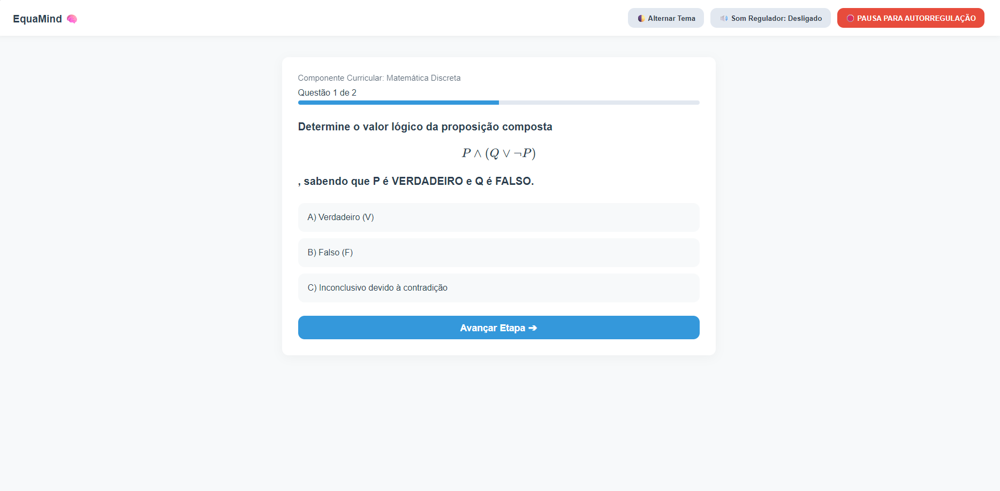
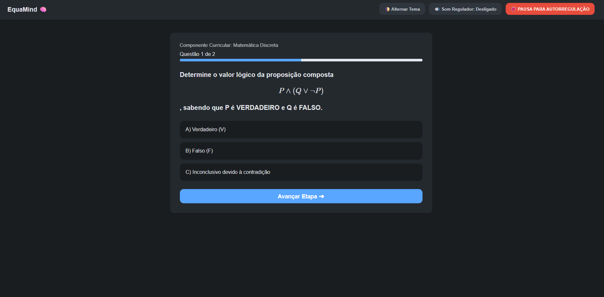
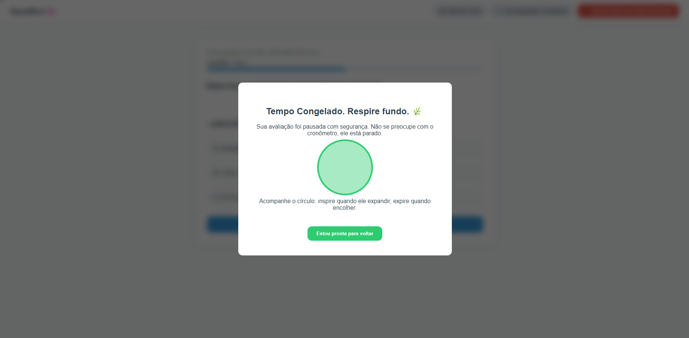

# 🧠 EquaMind — Avaliação Inclusiva e Tecnologia Assistiva

> **Protótipo funcional de aplicação web para avaliações lógicas e matemáticas sob as diretrizes do Desenho Universal para a Aprendizagem (DUA).**

---

## 👩‍💻 Autoria e Propriedade Intelectual

Projetado, codificado e documentado de forma individual por **Estefany Wanessa Tavares Soares** como requisito para a 2ª Verificação de Aprendizagem (2ª VA) na disciplina de **Educação Inclusiva** do curso de **Licenciatura em Computação** da **Universidade Federal Rural de Pernambuco (UFRPE)**.

* **Repositório Oficial:** [https://github.com/ewanessa/equamind.git](https://github.com/ewanessa/equamind.git)

---

## 📌 Sobre o Projeto

O **EquaMind** nasce como uma resposta tecnológica e humana às barreiras impostas por formatos tradicionais de exames em cursos de exatas. O objetivo principal é mitigar os componentes ansiogênicos de avaliações acadêmicas, oferecendo suporte contínuo a estudantes neuroatípicos (TDAH, TEA, dislexia) e discentes vulneráveis a picos de estresse situacional agudo e crises somatoformes (CID 10 F44).

---

## 🛑 Funcionalidades de Acessibilidade e Assistência

* **Visualização Modular:** Apresentação restrita a uma única questão por tela, evitando a sobrecarga cognitiva e visual.
* **Ajuste Sensorial Interativo:** Alternância instantânea de paleta de cores para tema escuro (alto contraste/baixo estresse visual).
* **Renderização Matemática de Alta Precisão:** Integração com MathJax para visualização nítida e limpa de fórmulas de lógica e exatas.
* **Mecanismo de Salvaguarda (Pausa para Autorregulação):** Botão de emergência que paralisa a avaliação, limpa temporariamente enunciados complexos e exibe um modal dinâmico com guia de respiração mecânica para prevenção de crises.

---

## 📸 Demonstração da Interface

### 1. Interface Padrão e Renderização de Fórmulas


### 2. Customização Sensorial (Tema Escuro Ativado)


### 3. Tela de Emergência e Respiração Guiada (Pausa de Autorregulação)


---

## 🛠️ Tecnologias Utilizadas

* **HTML5:** Estrutura semântica e acessível.
* **CSS3:** Design responsivo, estilização e manipulação de temas visuais.
* **JavaScript (ES6+):** Controle de fluxo, manipulação do DOM e lógica dos modais de emergência.
* **MathJax v3:** Renderização dinâmica de notações matemáticas em LaTeX.

---

## 🚀 Como Executar o Projeto Localmente

1. Clone o repositório:
   ```bash
   git clone [https://github.com/ewanessa/equamind.git](https://github.com/ewanessa/equamind.git)
